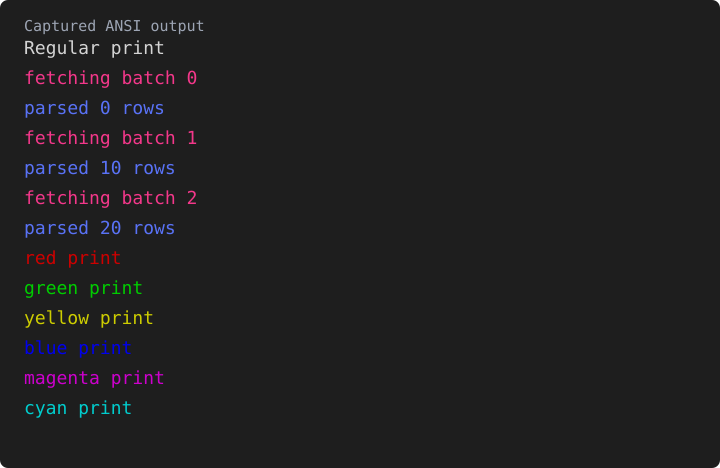

# vizible

[self-link to github repo](https://github.com/ible-ai/vizible)

Minimal, deterministic color-coded debugging for Python.

`vizible` provides a way to track execution flow by assigning a deterministic
color to each `dprint` call site.

```sh
pip install vizible
```

## Features

- **`dprint(*args)`**: Prints text in a truecolor RGB value derived from the calling file name and line number. The value is stable while that call site stays at the same path and line.
- **Readable everywhere**: The hash picks a vivid hue, and every color keeps at least 3:1 contrast on both dark and light terminal backgrounds.
- **A drop-in `print`**: `dprint` and the named helpers take `print`'s arguments (`sep`, `end`, `file`, `flush`), so you can swap one in for any `print` call.
- **Classic ANSI Colors**: Quick access to `red`, `green`, `yellow`, `blue`, `magenta`, and `cyan`.
- **Zero Configuration**: Works out of the box in most modern terminals, with no dependencies.

## Usage

```python
from vizible import blue, cyan, dprint, green, magenta, red, yellow

print("Regular print")

# Each dprint call site gets a deterministic color, so the two
# lines inside this loop are told apart without reading them.
for step in range(3):
    dprint("fetching batch", step)
    dprint("parsed", step * 10, "rows")

# ANSI color helpers
red("red print")
green("green print")
yellow("yellow print")
blue("blue print")
magenta("magenta print")
cyan("cyan print")
```

## Example Output



This is a generated rendering of the ANSI stream emitted by the example, not a
live terminal. The `dprint` lines preserve their exact emitted RGB values.
The named helpers emit standard ANSI SGR color codes (`31`, `32`, and so on),
so their final RGB values deliberately follow your terminal's palette; the
preview uses the xterm default palette for those lines.

## More

```python
import sys
from vizible import dprint

# Anything print accepts: write to stderr, keep stdout clean for real output.
dprint("cache miss", key, file=sys.stderr, flush=True)

# Inside your own logging helper, color by the line that called the helper
# instead of the one dprint line inside it (same idea as warnings.warn).
def trace(*args):
    dprint("[trace]", *args, stacklevel=2)
```

Multi-line values are colored line by line, so they stay colored in `less -R`
and CI log viewers.

Set the [`NO_COLOR`](https://no-color.org) environment variable to print plain
text, for example when redirecting debug output to a file.

## Why?

When debugging loops or long log streams, visual pattern matching is faster than reading text. `vizible` allows you to "see" where your logs are coming from without reading file/line prefixes.
